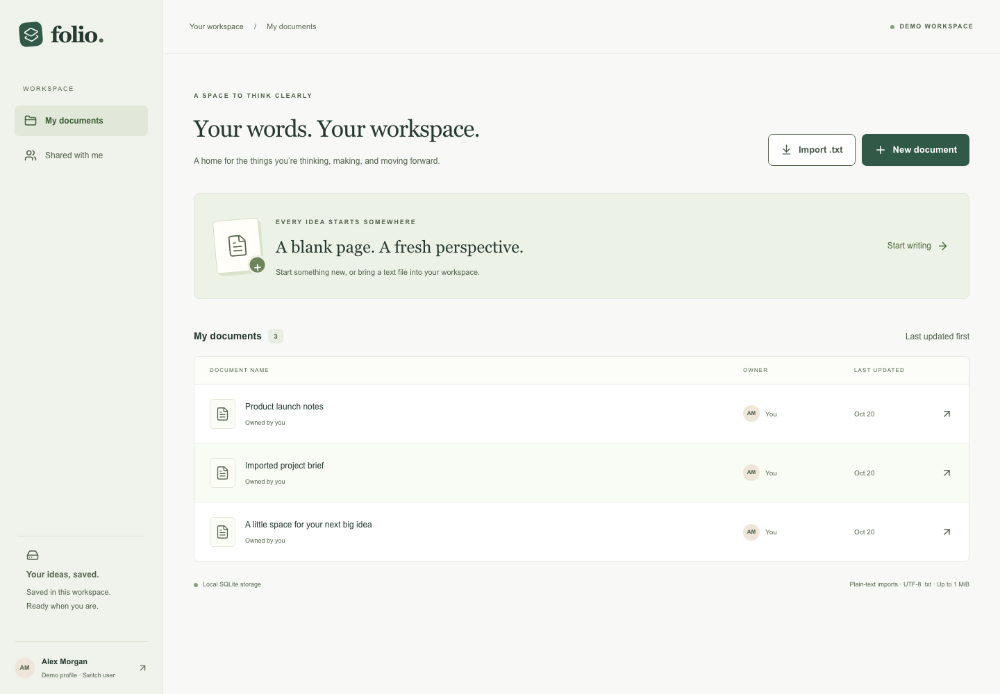
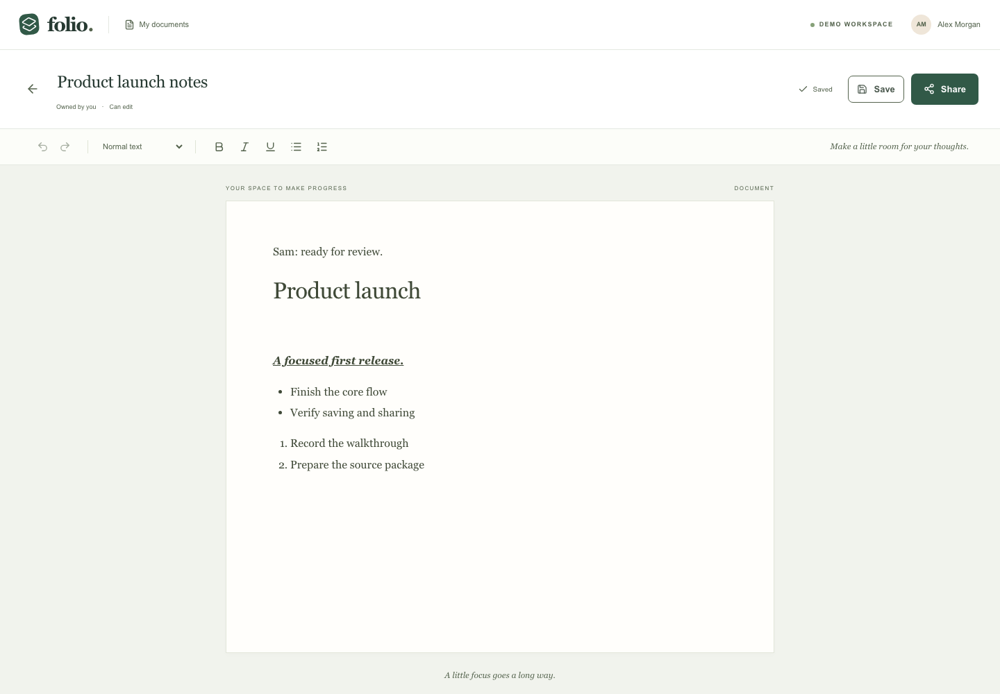

# Folio

A document workspace for writing, importing text, and sharing with demo teammates. Built with Next.js, React, Tiptap, TypeScript, Drizzle, and SQLite. Runs locally or as one hosted Node.js instance with persistent SQLite. No external database or remote fonts are required.

## Quick start

Use **Node.js 24.22.0 LTS** (pinned in `.nvmrc` and `.node-version`) and npm 11.12.1. If you use nvm:

```bash
nvm install
nvm use
npm ci
npm run setup
npm run doctor
npm run dev
```

Open **http://127.0.0.1:3000**. Use the same hostname consistently so the demo session cookie stays available. The server binds to loopback only.

`setup` generates an ignored `.env.local` with a random signing secret, migrates the local SQLite file, and seeds fictional demo users plus a sample document. It preserves existing documents and shares. Initial dependency installation requires internet access; the running app uses no external application services.

## One-command local launcher

After installing dependencies, run `./start-local.sh`. It selects the workspace-local Node LTS runtime if present, checks the Node version, safely initializes the database, builds the app, and starts local production mode. It preserves existing documents. Press Ctrl+C to stop.

## Local production mode

```bash
npm run build
npm start
```

Both development and production-start modes use the same local database by default. Stop the development server before starting production on port 3000. Rebuilding or restarting does not remove stored documents.

## Try the whole flow

1. Continue as **Alex Morgan**. Create a document and rename it in the editor header.
2. Write, format, and wait for **Saved**. Refresh to verify persistence.
3. Use **Share**, choose **Sam Taylor**, and grant access.
4. Use the avatar to switch to Sam; open **Shared with me** and edit the document.
5. Switch back to Alex to see Sam's saved changes.
6. Select **Jordan Lee** to verify an unshared profile cannot open it.
7. From the dashboard, use **Import .txt** with `examples/sample.txt`.

These are intentionally selectable **demo identities**, not password-protected accounts. Access checks are enforced on the server relative to the selected identity. Do not use this public demo to store sensitive documents.

## Features and boundaries

- Create, owner-only rename, open, and edit documents.
- Bold, italic, underline, headings 1/2, bullet lists, numbered lists, undo, and redo.
- Debounced autosave, manual Save/Retry, and Ctrl/Cmd+S.
- Owner-controlled grants; recipients can edit the body but cannot rename or manage sharing.
- Owned and Shared with me views.
- UTF-8 `.txt` import, including empty files, up to **1 MiB**. Imports create editable documents, preserving lines and literal text. Other formats are rejected.
- Documents are limited to a 2 MiB request budget with structure/node/depth checks.
- Atomic version checks prevent a stale editor from silently overwriting a newer save. Conflicts preserve the local draft and offer copying before confirmed reload. There is no automatic merging or real-time editing.
- Failed saves retain the draft in the current tab. This is not an offline-first application: closing the tab can lose unsaved content. Navigation controls attempt saving and browser unload warns while dirty.
- Stored data is in `data/folio.sqlite`, outside build output. Sharing is demonstrated between profiles on the same local application instance.

The current scope excludes `.docx`/PDF/Markdown import, export, attachments, comments, version history, real authentication, and document deletion.

## Configuration

`npm run setup` creates defaults automatically. For custom configuration copy `.env.example` to `.env.local`, set values, and run migration/seed commands. Process environment variables take precedence.

| Variable         | Purpose                                                 |
| ---------------- | ------------------------------------------------------- |
| `DATABASE_PATH`  | SQLite file; default `./data/folio.sqlite`              |
| `SESSION_SECRET` | Server-only HMAC signing secret; at least 32 characters |

```bash
npm run db:migrate
npm run db:seed
```

Migrations are explicit and versioned (`db/migrations/0001_initial.sql`); there is no destructive reset on startup. Seeds are idempotent. Do not delete the database to troubleshoot: deleting it discards your local work. To back up data, stop the app and copy the `data/` directory together, including any SQLite companion files.

## Quality checks

```bash
npm run doctor
npm run check
npx playwright install chromium firefox webkit
npm run test:e2e
```

`check` runs formatting, ESLint, strict TypeScript, service integration tests, and a production build. Run it before `test:e2e`; browser tests use that build. Formatting can be fixed with `npm run format`, and supported lint fixes with `npm run lint:fix`.

Service tests use temporary SQLite files. E2E starts an isolated production server on **127.0.0.1:3107**, with a temporary database and fictional seed. The restart test uses port **3108**, and the hosted-startup test uses **3111**. All three ports must be free. Test databases and signing secrets are generated by the harness; application data is never reset. The test harness stops its own processes and removes its own temporary directory on normal shutdown.

The full suite runs in Chromium; a core edit/save/share test also runs in Firefox and WebKit. Tests cover real UI/API/database flows, file validation, sharing, unauthorized access, failed saves, queued edits, conflicts, session switching, restarts, narrow screens, and keyboard dialog behavior. Axe checks key screens for serious/critical accessibility violations. Browser runtime and hydration errors fail tests.

Failure evidence is in `test-results/` and `playwright-report/`:

```bash
npx playwright show-report
npx playwright show-trace test-results/<failed-test>/trace.zip
```

These commands run locally. Do not increase retries or ignore failures to obtain a passing report.

## Troubleshooting

- **Wrong Node version:** select the version in `.nvmrc` before installing dependencies. Run `npm ci` again after switching Node if the native SQLite driver reports an ABI mismatch.
- **Database not initialized / secret missing:** run `npm run setup`, then `npm run doctor`. Diagnostics never print the secret.
- **Port already in use:** stop the process you started, or use `npm run dev -- --port 3001`. Do not stop unrelated processes. E2E requires its documented dedicated ports.
- **Save conflict:** copy local text, then choose Reload latest if you want the stored version. Draft text copying preserves text; it is not a rich-text backup.
- **Profile changed in another tab:** the editor refuses to save as the newly selected identity. Copy your draft and reopen under the original profile.
- **Import rejected:** check extension, UTF-8 encoding, and the 1 MiB limit. There is no conversion for binary formats.

## Toolchain choices

Node 24.22.0, Next.js 16.4.2, React 19.3.1, Tiptap 3.32.0, Drizzle 0.45.4, better-sqlite3 13.0.3, and TypeScript 6.0.3 are pinned. Exact versions for every package are in `package.json` and the lockfile.

TypeScript 7 was rejected because the current TypeScript ESLint tooling does not support it. ESLint 10 uses compatible TypeScript and React Hooks rules directly; the framework preset was removed because it introduced an advisory through its glob dependency. Unused Drizzle Kit was removed; SQL migrations are committed and applied transactionally. This keeps a stable compatible toolchain without forcing vulnerable or unsupported packages into the project.

See [ARCHITECTURE.md](ARCHITECTURE.md) for data flow and tradeoffs, [AI_WORKFLOW.md](AI_WORKFLOW.md) for the assisted development process, and [DEPLOYMENT.md](DEPLOYMENT.md) for Docker hosting.

## Live demo

Try [Folio online](https://folio-production-2ec9.up.railway.app). The demo uses the same three selectable fictional profiles and a persistent SQLite volume. Use fictional content because anyone can select these profiles. Local setup requires no hosting account.

## Screenshots




